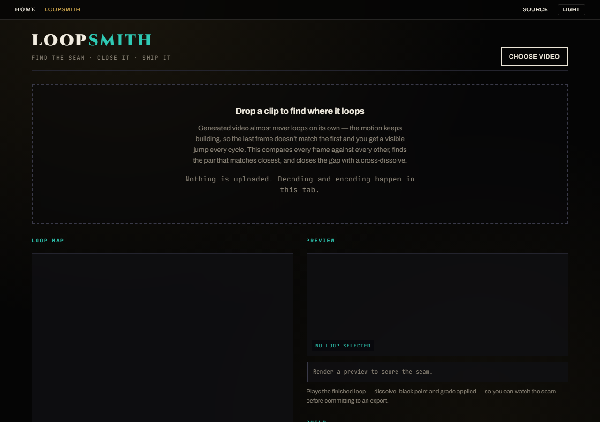

# Loopsmith

A browser tool that turns a video clip that doesn't loop into one that does. Generated video almost
never loops on its own: the motion keeps building, so the last frame never matches the first and
every cycle shows a jump. Loopsmith compares every frame against every other, finds the pair that
matches closest, and closes the gap with a cross-dissolve arranged so the wrap is frame-continuous.
The bottom half of the page does the same for audio, with a spectral comparison instead of a
pixel one, an equal-power crossfade, and a seam report that tells you whether the join will click.

Everything runs in the tab. Nothing is uploaded: decoding, analysis, preview and export (VP9/WebM,
or MP4 where the browser can record it; WAV for audio) all happen in the browser. For a final MP4
with proper control over banding in dark footage the page prints the matching `looper.py` command,
a small Python script that does the same build with ffmpeg and x264.



## Architecture

- `public/projects/loopsmith/index.php`: the whole tool, one page. Styles, the video analyser, the
  audio analyser (its own FFT, no dependencies) and the exporters are all in this file. The only
  server-side work is a handful of PHP `include`s for the shared page chrome.
- `public/projects/loopsmith/looper.py`: the command-line build (`analyze`, `build`) for people
  who want x264 output or batch work. Needs Python 3, `numpy`, `Pillow` and `ffmpeg` on PATH.
- `public/projects/loopsmith/loopsmith.light.css`: the light-theme companion sheet, scoped under
  `html[data-theme="light"]`.
- No sample media ships in this repository: the page opens as a drop zone (see Configuration for how
  to give it a sample clip and sound of your own to open with).
- `public/includes/*`, `public/assets/site/*`: small stand-ins for the site chrome the page was
  built against (head, nav strip, stage backdrop, footer, theme toggle, `h()` escaper). Replace them
  with your own site's fragments if you drop the page into an existing site.
- `tests/smoke.py`: serves the tree with PHP's built-in server and checks the page and its assets.

## Quickstart

You need PHP 8.1 or newer on PATH (`php -v`). Python 3 is needed only for the smoke test and
`looper.py`.

```
git clone https://github.com/printedwicked/loopsmith
cd loopsmith
php -S 127.0.0.1:8080 -t public
```

Open <http://127.0.0.1:8080/projects/loopsmith/>. Set the frame rate (bottom right of the Build panel,
default 24) so it matches your source, then drop a clip onto the page or use "Choose video". Analysis
runs in the tab, the preview renders itself when it finishes, and the seam score under the preview
says whether the loop worked. The bottom half takes a sound file the same way.

Run the smoke test from the repository root:

```
python tests/smoke.py
```

The command-line build, for an x264 MP4:

```
pip install numpy pillow          # and ffmpeg on PATH
cd public/projects/loopsmith
python looper.py analyze INPUT.mp4
python looper.py build INPUT.mp4 loop.mp4 --start 1.25 --end 4.75 --fade 14
```

`analyze` prints the frame-delta statistics and the best candidate windows; `build` cuts the window
you choose and closes it with a dissolve. The page prints the exact `build` command for whatever
window and settings you picked in the browser.

`looper.py` clears and recreates its frame folders with `rm -rf` / `mkdir -p`, so for now it runs on
Linux, macOS or Git Bash on Windows (not plain cmd.exe or PowerShell).

## Reading the result

Two ratios appear on the page and they measure different things. The multiplier in the candidate
list is the raw seam before any dissolve and only ranks windows against each other; the seam under
the preview is the finished loop scored the same way after the dissolve, and that is the number that
says whether it worked (at or below 1.0 the seam changes less than an ordinary frame does). The long
form, with the audio half's seam report and the reasons behind each control, is in
[docs/guide.md](docs/guide.md).

## Configuration

There is nothing to configure on the server. Two constants in `index.php` choose what the page opens
with: `DEMO` (in the video script, near its end) names a clip and `DEMO_AUDIO` (in the audio script)
names a sound; both are `null` here, so both halves open empty. Put a short VP9 WebM and a short mp3
beside `index.php` and set the constants to their file names, and the page opens with them already
analysed and looping, which shows a visitor what the tool does before they go looking for a file.

The page loads three Google Fonts families. It works without them (the fallback stack is real), so it
is fine behind a strict CSP or offline. H.264 MP4 input needs a browser with proprietary codecs
(Chrome or Edge); WebM decodes everywhere.

## Screenshots

- `docs/screenshots/loopsmith.png`: the page served from this tree with `php -S`, rendered by
  headless Chrome in its opening state (no file loaded). Nothing in it is user data.

## Tests

`python tests/smoke.py`: `php -l` on every PHP file, `py_compile` on `looper.py`, then it serves the
tree with `php -S`, fetches the page, the companion stylesheet and the chrome files, checks each
answers 200 with the expected content type, checks the root redirects to the page, and checks that no
PHP warning leaked into the page.

## Licence

Licensed under the GNU AGPL-3.0. Copyright (c) 2026 Printed Wicked.
